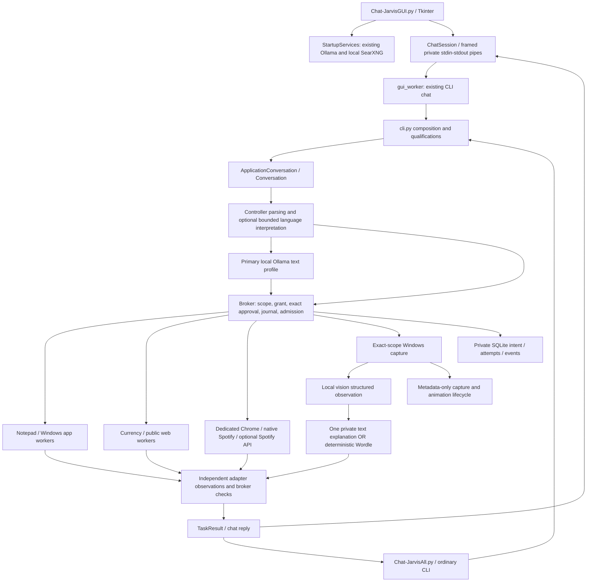

# JARVIS current project state

## Current update: 2026-10-18

M6 voice is implemented but **not fully qualified**. This PC selects approved
local small.en CPU recognition and Kokoro/Michael speech; base.en is retained.
The GUI uses an installed offline Windows wake grammar, fixed local acknowledgement
and a bounded Whisper command window. Capture timing/resampling and the prepared
microphone handoff have been corrected; measured post-ack input readiness is about
66-67 ms. Settings exposes the wake call, devices, timing and explicit speech engine.
Stop/Esc/global stop and all existing broker/registration/qualification gates remain.

Actual recognition gates failed: general corpus **2/7**, app-spelling corpus **1/4**.
The owner confirmed literal "this cord" became "Discord" with automatic app-name
hints. Those hints now default OFF and are explicitly disabled privately; optional
custom spellings remain available. No native retest after disabling hints, and no
claim that original recognition accuracy is fixed. Audio/transcripts stay transient.
Latest full fake suite: **1722 passed in 62.07s**; lint, formatting, dependencies and
whitespace checks pass. Detailed commands, earlier results and failures belong in
[BUILD_LOG](BUILD_LOG.md), [M6 evidence](M6_TEST_REPORT.md) and [voice setup](VOICE.md).

Spotify play requests select the first fresh matching result, retaining explicit
artist/owner constraints; search-only requests still list results. Six preserved
local-model action reports passed and still match their contracts. Voice cleanup
has not refreshed native app/media qualification. No later milestone is implied.

## Original project audit: historical snapshot

The following audit records the 2026-10-17 baseline. Its test counts and M6 setup
statements describe that snapshot; use the current update and linked evidence
above for subsequent changes. The full audit is retained rather than copied into
additional competing progress lists.

Audit date: **2026-10-17, Asia/Kuala_Lumpur**. Repository baseline: **d96c1c4**, `Add M5 screen assistance, animated companion and natural vision answers`.

M6 implementation update, same date: working tree now adds local PTT/audio/GUI
integration. It is **IMPLEMENTED BUT NOT FULLY VERIFIED**: last full run 1593 passed,
62 voice/UI cases passed, real device enumeration succeeds, and approved pinned
base.en setup/offline CPU loading pass. Attended microphone/speaker/integrated
recognition succeeded for two synthetic phrases in r4 after fixing settings/save
and native import startup. Testing stopped at the owner's request. A subsequent
SAPI event-interest correction is untested; audible output/interruption and full
screen integration remain pending. See
[M6 evidence](M6_TEST_REPORT.md), [voice architecture/settings](VOICE.md) and ADR
0020. Original audit-only observations below retain their historical context;
capability statements have been updated for M6. No commit was created for M6.

Original audit scope, before the separately approved M6 implementation: no tests, inference, service probes, Windows/browser/media actions, installation or downloads were run during that audit. Only this report and `JARVIS_AI_HANDOFF.md` were created. Python AST parsing covered 101 source modules, 16 scripts and 31 test/helper modules without importing them; there were 482 JSON evaluation artifacts. These are historical inventory counts. M6 subsequently added modules/dependencies and ran the explicitly recorded checks in M6_TEST_REPORT.md. Older source line numbers below refer to the audit snapshot; symbols remain the preferred navigation reference.

## 1. Executive summary

JARVIS is an existing Windows desktop assistant, not just a prototype CLI. It has a dark Tkinter chat GUI, terminal chat, fixed-loopback local Ollama inference, a transactional permission broker, real Notepad and discovered-application lifecycle control, bounded public research, generic provider-supported currency conversion, dedicated Chrome YouTube control, native Spotify song/playlist search and playback, real read-only screen understanding, deterministic Wordle advice and an animated desktop orb.

The GUI and terminal share the same backend. A GUI-specific launch choice automatically selects attended real app/media controls; ordinary profile/CLI defaults remain simulated. Each capability still requires its own configuration, identity and qualification. The GUI does not bypass the broker.

The inspected private setup selects `qwen3:8b` for text and `qwen2.5vl:3b` for vision. Screen reads feed structured observations into one read-only primary-model explanation call. Main-display questions need no window-selection prompt under the owner's standing grant. This is not a general visual computer-control system.

The implementation has substantial safety and regression work, but reliability is uneven. M3.5's broad semantic/freshness gate and M5's general perception/platform qualification remain incomplete. Netflix and Spotify Web API paths lack completed live account/service validation. Local voice is now implemented but awaits real audio/model acceptance. Durable personal memory, reminders, calendars, email, persistent routines and proactive scheduling remain unimplemented.

The next step is approved STT setup and attended M6 validation alongside remaining reliability/configuration work. Do not rebuild the GUI or treat later roadmap labels as proof that their features are absent.

## 2. Status and evidence terminology

| Status | Meaning in this report |
| --- | --- |
| IMPLEMENTED AND VERIFIED | Existing implementation plus recorded tests for the stated bounded slice; not a universal compatibility claim. |
| IMPLEMENTED BUT NOT FULLY VERIFIED | Working paths and some evidence exist; important acceptance/platform/semantic coverage remains. |
| PARTIALLY IMPLEMENTED | Only part of the requested broader feature is implemented. |
| SCAFFOLDED / PLACEHOLDER | A contract/example exists without the corresponding functioning service. |
| NOT IMPLEMENTED | No implementation path found after source/dependency/entry-point searches. |
| UNKNOWN / INSUFFICIENT EVIDENCE | Current functionality cannot be established from available source/evidence. |

Historical native evidence demonstrates a particular PC, app version, account state and revision. A current-source local-model simulation gate is a different evidence layer and does not refresh every native test. There was no current runtime or account-state probe in this audit.

## 3. Actual repository architecture

Python is the application language. The package uses standard-library dataclasses, protocols, argparse, SQLite, TOML, threading/queues and asyncio, with Pydantic at external boundaries and HTTPX for model/bootstrap traffic. Native Windows work uses ctypes, COM/UI Automation through comtypes, WinRT media APIs and supervised Python workers. Chrome uses Playwright's synchronous API with installed stable Chrome. PDF research extraction uses pypdf. Tkinter/Tcl and Windows GDI+/DWM provide presentation; no Electron/web frontend or GUI HTTP server exists.

The diagram is intentionally not an unrestricted model-agent loop. Explicit owner scope, deterministic routes, special-purpose workflows and strict stage schemas constrain what the model can propose. Some read paths use more than one bounded model call. The orb is presentation, not another agent.

### Modules and responsibilities

| Area | Important implementation |
| --- | --- |
| Entry/composition | `src/jarvis/__main__.py`, `cli.py:19 main`, `bootstrap.py:41 build`; repository launchers in `scripts/`. |
| Contracts/inference | `domain.py:9 State`, `models.py:156 BaseProfile`, `models.py:204 OllamaProfile`, `ollama.py:23 OllamaProvider`, `prompts.py:293 context_messages`. |
| Authority/execution | `core.py:38 Broker`, `policy.py:8 authorize`, `tools.py:19 Registry`, `storage.py:62 Store`. |
| Conversation | `conversation.py:24 Conversation`, `request_language.py:202 normalize`, `assistant.py:375 interpret`, `youtube_flow.py:21 YouTubeFlow`, `spotify_flow.py:17 SpotifyFlow`. |
| Native adapters | `notepad.py`, `win_native.py`, `win_worker.py`, `application_tools.py`, `application_worker.py`, `application_identity.py`. |
| Retrieval | `currency_tools.py`, `public_data.py`, `public_catalogue.py`, `web_tools.py`, `web_provider.py`, `web_transport.py`, `web_extract.py`. |
| Media | `media_tools.py`, `browser_worker.py`, `browser_transport.py`, `spotify_desktop.py`, `spotify_accessibility.py`, `windows_media.py`, `spotify_api.py`. |
| Presentation/perception | `gui*.py`, `screen_*.py`, `wordle.py`, `companion*.py`. |

## 4. Actual application startup and shutdown

### Dedicated GUI

1. The user runs `.\.venv\Scripts\pythonw.exe scripts\Chat-JarvisGUI.py`. The script imports the combined terminal helper and constructs `StartupServices` using `%LOCALAPPDATA%\Jarvis` (`scripts/Chat-JarvisGUI.py:11`).
2. `gui.main` creates a Tk root and `ChatWindow(..., auto_start=True)` (`gui.py:456`). A timer initiates connection; a background thread calls `session.start(real=True)` (`gui.py:248 toggle_session`). No app/media action or screen capture is requested merely by launch.
3. `Chat-JarvisAll.py:16 chat_command` builds an explicit configuration/report argument list and checks required files. It selects the private `profiles/notepad-m2-concurrent-v1.toml`, real Notepad/app/browser/media flags and the six `m5-screen-handoff-*-r1.json` qualification reports. `screen.toml` is included only if it exists. Missing required setup/report files prevent worker launch.
4. `StartupServices._prepare` loads private `gui-startup.toml`, the selected text profile and web config. A two-thread executor prepares Ollama and SearXNG concurrently (`gui_startup.py:55`).
5. Ollama startup verifies the registered standalone executable path/hash, expected runtime version and pre-existing cloud-disabled setup evidence. It reuses a matching available server or starts the approved executable with process-local `OLLAMA_NO_CLOUD=1`, `OLLAMA_HOST=127.0.0.1:11434`, private `OLLAMA_MODELS`, profile context and request logging disabled. A newly started process must produce a fresh `Ollama cloud disabled: true` log line. A reused server is not newly attested merely by version/loopback.
6. Startup checks installed model tags, preloads only the configured text model through an empty `/api/generate` request, and independently checks `/api/ps`. It never pulls weights. Vision is checked and loaded on screen requests, not preloaded as a second always-resident model.
7. SearXNG preparation uses installed Docker, only an allowed local named-pipe context and the Linux engine. It can start installed Docker Desktop, start the owned stopped container or recreate the removed ephemeral container using the cached digest-pinned image, existing private mounts, loopback-only port and `--pull never`. It verifies identity/network/mount/restart settings and health. No installation/image pull/startup policy change occurs. Search preparation failure gives a warning while local chat may continue; unavailable model preparation blocks chat. Executor completion can still delay startup while the other preparation branch finishes.
8. `ChatSession._start` changes the child module from `jarvis` to `jarvis.gui_worker` and launches a hidden Python subprocess with private pipes (`gui_session.py:63`). `gui_worker.main` calls the existing CLI and frames its output callbacks; model strings cannot forge event framing (`gui_worker.py:11 EventWriter`).
9. CLI strictly loads configurations, inspects the local model, validates each selected real-mode qualification, composes adapters, opens the appropriate private journal and creates a fresh session. General apps wrap `Conversation`; screen assistance attaches separately. Startup recovery classifies unfinished tasks without replay. A global hotkey must register successfully before attended operation (`cli.py:731–808`).
10. A `ready` pipe event enables input. Missing registrations, changed binaries, invalid profiles, stale/mismatched qualifications or hotkey conflict fail closed, with Details diagnostics.

The terminal combined launcher uses the same configuration construction but **does not call `StartupServices`**. It expects the runtime and search infrastructure to be available. Ordinary `python -m jarvis chat` requires explicit configs/real flags and does not inherit the dedicated GUI's always-real selection.

### Shutdown

GUI Stop/Esc sends `/stop`; End session/window close cooperatively sends `/stop` then `/quit`. A daemon reader drains output; reaping waits for the child (`gui_session.py:143 close`, `gui.py:433 close`). CLI closes screen/indicator, media workers, SQLite and the model client (`cli.py:810`). The managed Chrome context closes; unrelated apps are not force-killed. Ollama/Docker/SearXNG remain running. Stop blocks new admissions; it cannot undo an already delivered effect. A hung backend's cooperative exit is a potential wait risk, not demonstrated as a current shutdown failure. The companion additionally has its own bounded shutdown watchdog.

## 5. Current GUI implementation

The GUI is implemented, polished beyond a basic text box, and connected to the actual tool backend. `gui.py`, `gui_conversation.py`, `gui_widgets.py`, `gui_scrollbar.py`, `gui_art.py`, `gui_theme.py` and `gui_chrome.py` implement dark slate rounded bubbles, smooth pixel scrolling, native branded titlebar, antialiased logo/send artwork, auto-growing composer, correct focus/placeholder state, copy/full-message reader, latest-message navigation, elapsed-time thinking dots, Stop/Esc, visible attended/global-stop text and Details diagnostics.

Tk owns the main UI thread. Startup and pipe-reading use background threads; a bounded event queue bridges to UI timer polling. The worker frames `ready`, `reply` and `diagnostic` records; parent-side events also include startup progress/closure. Responses are whole completed messages, **not token streaming or displayed chain of thought**. `request_line` flattens multiline input into one bounded terminal request, maximum 4096 characters (`gui_session.py:46`). Transcript rendering retains at most 256 bubbles/150,000 characters (`gui_conversation.py:313`); backend ordinary model history is separately limited to 16 messages.

Existing slash commands can be entered in the GUI. GUI/CLI share apps, web, currency, media and configured screen reads. M6 now selects local "JARVIS" wake addressing, always-on spoken replies and Settings beside Details; manual audio buttons/toggle are removed. Addressed transcripts call the same send_text path; bounded half-duplex audio is supervised off Tk and pauses through processing/speech. Settings can disable microphone listening; Stop/Esc/global stop remain usable. The explicit fixture retains manual PTT. Earlier native PTT recognized two synthetic phrases; current wake changes and spoken output remain unverified after the owner stopped tests. Developer inspection/registration/evaluation/labs remain CLI/scripts. No model picker, permission wizard, reminders pane or account manager exists.

## 6. Models, context, planning and error handling

`Provider` is a protocol (`models.py:337`) with fake and Ollama implementations. One selected text profile supplies identity, context/output reservations, options, prompt/schema versions, model-turn budget and task deadline. Real transports reject remote model metadata, wrong response identity, tool-call envelopes, duplicate/nonfinite/extra JSON fields and incomplete output. Fixed loopback, no proxy inheritance and no redirects are enforced (`ollama.py`). There is no cloud fallback, automatic best-model selector or live GUI model switching. Changing a trusted profile selects a model at startup and may require new qualifications.

The current private primary profile omits `assistant_version`, therefore uses **`legacy`**, with `planner-m2-v10`, `decision-m2-v1`, context 4096, output 512, task 120 seconds, `think=false`, `keep_alive=2m`, targeted window input and operator-verified cloud-disabled evidence. This matters: optional `assistant-v1`/`assistant-v2` semantic planning code and `assistant-fast.toml` do not prove those paths are active in normal combined chat. The optional fast example uses larger reservations and per-stage options; it is a candidate requiring its own qualification.

Conversation history is in-memory and bounded. Context packing drops oldest history pairs to preserve current owner request and controller scope, using byte limits and a byte/3 token estimate (`prompts.py:context_messages`). This estimate is not the actual tokenizer. No persistent semantic memory or retrieval index exists. Currency operands/context and selected media/window references are specialized transient state, not personal memory.

Action understanding combines deterministic owner intent, literal target resolution and an optional separately qualified bounded model language stage (`request_language.py:ceiling`, `normalize`). The stage cannot invent target text, URLs, paths or operation families. This explains why wording outside recognized families can still fail despite local AI inference. The optional semantic assistant supports bounded Decimal operand expressions and checks, but is not a universal planner.

Multi-step search/open/play is implemented as explicit `YouTubeFlow`/`SpotifyFlow`, with separate broker transactions, fresh references and budgets. Unique matches may proceed; real ambiguity prompts numbered choices. Arbitrary task decomposition, parallel autonomous action chains and durable user-authored routines are absent.

Broker recovery (`core.py:734`) and adapters retain unknown-outcome/manual-review state. Manual review controls still exist; prior conversation requests to remove them are not evidence they were removed from the current revision. Known read failures produce honest failure/fallback messages; unknown delivered Windows/media effects are not blindly retried.

## 7. Feature-status matrix

G = GUI; C = CLI/terminal. Real means implemented native/network execution, conditional on configuration/qualifications. Evidence labels below refer to bounded historical validation.

| Feature | Status | G / C | Execution, provider and evidence | Important limit / source |
| --- | --- | --- | --- | --- |
| Simulated broker/journal | IMPLEMENTED AND VERIFIED | Shared / yes | Fake model/desktop; broad regressions | Safe core, not real app proof; `core.py`, `storage.py`. |
| Local text chat | IMPLEMENTED AND VERIFIED | Yes / yes | Ollama/qwen3; live and offline records | No universal answer accuracy; `ollama.py`, `conversation.py`. |
| Natural general action wording | IMPLEMENTED BUT NOT FULLY VERIFIED | Yes / yes | Qualified language stage + grammar | Bounded verb/target families; `request_language.py`. |
| Optional semantic/fast assistant | IMPLEMENTED BUT NOT FULLY VERIFIED | Profile-dependent / yes | Local schema stages; live corpus failures and passes by version | Not selected in combined profile; `assistant.py`, examples. |
| Desktop GUI | IMPLEMENTED AND VERIFIED | Yes / terminal alternative | Tk presentation, framed child backend, recorded GUI checks | M6 audio UI added but native audio pending; no full settings/onboarding. |
| Approved service bootstrap | IMPLEMENTED AND VERIFIED | Automatic / GUI launcher path only | Existing Ollama/Docker/SearXNG; mocked cold paths and recorded local startup | New machine still needs provisioning; `gui_startup.py`. |
| Notepad lifecycle | IMPLEMENTED AND VERIFIED | Yes / yes | Real packaged Notepad and simulation, attended lab | Close only independently empty/unmodified/single-tab; `notepad.py`. |
| Discovered installed-app lifecycle | IMPLEMENTED BUT NOT FULLY VERIFIED | Yes / yes | Real Windows AppsFolder adapter, several attended apps | Not every app/device; `application_*.py`. |
| Public web research | IMPLEMENTED BUT NOT FULLY VERIFIED | Yes / yes | Local SearXNG API + separate public HTTPS fetch; 10/10 narrow gate | Broad semantics/freshness incomplete; `web_*.py`. |
| Generic currency conversion | IMPLEMENTED AND VERIFIED | Yes / yes | Frankfurter v2/ECB, Decimal, live provider + corpus | Daily indicative rates, provider membership not all ISO codes; `currency_*`, `public_*`. |
| Dedicated Chrome/YouTube | IMPLEMENTED BUT NOT FULLY VERIFIED | Yes / yes | Playwright + installed Chrome; attended search/play/pause/resume | Service/ad/manual-input/binary-update fragility; `browser_worker.py`. |
| Spotify native basic playback | IMPLEMENTED AND VERIFIED | Yes / yes | Selected Windows GSMTC session; physical stop evidence | No audibility proof; `windows_media.py`. |
| Spotify native song/playlist search | IMPLEMENTED BUT NOT FULLY VERIFIED | Yes / yes | Store Spotify UIA + exact-package URI + GSMTC; attended passes | Visible window/English UI/layout and exact result checks; `spotify_desktop.py`. |
| Optional Spotify Web API | IMPLEMENTED BUT NOT FULLY VERIFIED | Configurable / configurable | Credential Manager + API; deterministic tests | Live OAuth/Premium/device setup pending; `spotify_api.py`. |
| Netflix title search/open/login boundary | IMPLEMENTED BUT NOT FULLY VERIFIED | If enabled / if enabled | Dedicated browser semantic path and fake tests | Disabled here; no native account validation/protected playback; `browser_worker.py`. |
| Generic browser control | NOT IMPLEMENTED | No / no | No arbitrary website/DOM action tool | Public page reading is separate from browser automation. |
| Screen visual questions | IMPLEMENTED BUT NOT FULLY VERIFIED | Yes / yes | Real GDI capture + local vision + text explanation | General recognition and platform cases incomplete; `screen_*.py`. |
| Wordle advice | IMPLEMENTED BUT NOT FULLY VERIFIED | Yes / yes | Vision letters/color preprocessing + deterministic solver | Recognition/NYT compatibility limited; never types a guess; `screen_image.py`, `wordle.py`. |
| Bounded screen watching | IMPLEMENTED BUT NOT FULLY VERIFIED | Commands / commands | Foreground selected window, sample/expiry/change checks | Disabled here; native capture-watch evidence partly scripted vision. |
| Animated black orb | IMPLEMENTED AND VERIFIED | Screen lifecycle / same + preview | Native GDI+ alpha overlay, real fixture evidence | Latest smaller badge not visually retested; higher DPI/soak open; `companion*.py`. |
| PTT microphone/STT/TTS/audio devices | IMPLEMENTED BUT NOT FULLY VERIFIED | Yes / setup/lab scripts | CPU faster-whisper, PortAudio, Windows SAPI; 56 deterministic tests and real enumeration | STT assets/download approval and live mic/speaker acceptance pending; `voice*.py`, `gui_voice.py`. |
| Wake word/full duplex | WAKE IMPLEMENTED, UNVERIFIED / full duplex absent | GUI / no | Owner-approved local address recognition; no tests run | Bounded passive listening, pauses through replies; no speaker authentication. |
| Persistent personal memory/embeddings | NOT IMPLEMENTED | No / no | No personal memory store/index | Journal/history/caches are different concepts. |
| Reminders/durable scheduler/calendar/email | NOT IMPLEMENTED | No / no | No service/tool/provider/storage path | No persistent timed user tasks. |
| Proactive briefings/routines/notifications | NOT IMPLEMENTED | No / no | No such product workflow | Watch polling/bootstrap are narrow explicit activities. |
| Comprehensive settings/onboarding | PARTIALLY IMPLEMENTED | Diagnostics/commands / TOML and inspection | Strict config records and capability status | No unified GUI settings/wizard. |
| Hardware/model detection | PARTIALLY IMPLEMENTED | Bootstrap indirectly / doctor | Installed-model/runtime checks; historical hardware measurements | No automatic hardware-fit model selection/benchmark wizard. |
| Installer/public release/update management | NOT IMPLEMENTED | No / no | Python package metadata/locks/scripts exist | No consumer installer or signed release pipeline. |

## 8. Detailed M0–M5 inventory

### M0/M1: trusted simulated foundation and real local inference

Task/action state machines are separate. SQLite records tasks, canonical action intents, single attempts, redacted events and consumed approvals before external delivery. Short transactions do not contain external calls. Request fingerprints and logical step uniqueness prevent duplicate delivery; exact approval digests bind scope/revision/session/expiry (`storage.py:27 SCHEMA`, `:87 accept`, `:317 intent`, `:350 admit`). Success needs independent evidence, not a model statement. Recovery does not resume an unknown effect.

M1 uses a real HTTP schema adapter, bounded context and observational doctor. Local-only profile evidence is operator verified, not cryptographic server attestation. `m1-desktop-offline-validation.json` records real loopback inference with zero up physical adapters/no usable default routes before and after on 2026-10-09; snapshots are not continuous isolation proof. No such test was rerun for this audit.

### M2 and later Windows extensions

Notepad has private signed-binary/package registration, exact identity, UIA runtime IDs, process creation/session/owner checks, desktop availability, graceful close and stop. Empty-state checking compares text-range endpoints without reading document text; dirty state uses bounded native modify-state inspection and one-tab validation (`win_native.py:198 metadata`, `notepad.py:196 clean`). No save/discard or force kill is exposed.

Generic apps are discovered through trusted AppsFolder metadata, not an arbitrary model path. Only supported EXE/package launch identities are admitted. Package/delegate/runtime association proofs handle selected launcher patterns; not every entry is supported. Historical discovery counted 145 supported/51 unavailable entries, not 145 native app passes. Effects are open, focus/restore, minimize and normal close. Restore is part of focusing an iconic target, not a universal standalone action family. Window selection uses exact references internally and natural sole/selected matches; ambiguity can require choices.

Targeted input policy lets unrelated keyboard/mouse/focus activity coexist with lifecycle planning; it does not retarget to whichever window is foreground. Legacy exclusive input remains selectable. Generic typing, clicking, file editing, installing, device control and other OS adapters are absent. Some apps close to tray; verification claims window closure, not process termination. A single shared desktop lease/hotkey discourages concurrent attended sessions.

### M3: currency

Current-money intent is deliberately opt-in by explicit owner currency/rate requests (`currency_router.py:160 requests_currency_operation`); topic changes clear pending operands/pairs. Routing is still bounded language logic. Provider support is discovered through bounded validated `https://api.frankfurter.dev/v2/providers/ecb` metadata; pair rates use the fixed ECB route. English aliases normalize input without granting support. Historical metadata advertised 45 currencies; that number is dated evidence, not a hardcoded current list.

Only pair/config go to the provider; amounts are local. Decimal validates magnitude/precision and calculates conversions. Identity and supplied-rate paths do not fetch; they need valid cached membership, so cold metadata can block an otherwise local calculation. No local inversion/cross-rate invention occurs. Cache/provenance tracks effective date, retrieval/expiry and stale policy. JPY display rounds to whole units; other currencies use two decimals, not a complete ISO minor-unit table. Rates are daily reference estimates, not executable bank quotes. Source inspection and refresh remain available even when chat output is concise.

### M3.5: public research

The real initial search provider is **SearXNG**, using its JSON `/search` API. `SearchProvider` contracts and injected provider/fetcher composition are replaceable; no required Brave adapter, API key, paid subscription, random public instance or consumer search HTML scraping exists. Provider configuration accepts names, but naming another provider does not implement its adapter.

Search result snippets guide selection; selected pages are fetched separately through the trusted public HTTPS layer. Strict URL syntax, DNS/public-address/connected-peer checks, TLS, redirect revalidation, byte/decompression/time/process limits and credential-free HTTP transports separate public fetching from the exact loopback infrastructure exception. HTML/text/PDF extraction is bounded and does not run website JavaScript. Ordinary Chrome/Spotify cookies never reach research.

Source selection uses local-model result IDs plus deterministic alternatives, domain diversity, inaccessible-source handling and lower priority for some social/derivative hosts (`web_tools.py:227 execute`). Chunk ranking and fair text budgets reduce long-page starvation. Private setup currently allows two searches, five pages, 1 MiB per response and 3 MiB total; schema ceilings are separate from those selected values. Session caches have at most eight entries per section and default ten-minute TTL; they are not persisted (`web_cache.py`).

Claims bind retrieved excerpts/source IDs; publication/update can be unknown and retrieval time is distinct. Concise replies and `/sources` separate presentation from retained provenance (`web_tools.py:608`, `:661`). This does not guarantee semantic truth, complete web coverage, chronology or conflict resolution. Some sites block HTTP clients or need JS/login; there is no bypass/browser-cookie fallback. Query minimization uses the current owner turn and rejects recognizable private patterns, not a general proof that arbitrary personal information can never leak.

### M4: browser and media

Installed stable, signed Chrome is registered privately with binary identity. Playwright launches a headed persistent **dedicated JARVIS profile** with downloads disabled, extensions disabled and service workers blocked (`browser_worker.py:270`). It never attaches to everyday Chrome or copies its personal profile. Manual login can persist in this private browser profile. Updates require explicit registration review; an updated executable is not silently trusted.

YouTube supports bounded search, fresh result selection/open, current state and content-verified play/pause/resume. The worker pumps events while idle, and admits only reviewed semantic actions/constants. Ads, restrictions, navigation generations and user interaction can interrupt control; current-video inspection provides a controlled handoff after manual ad skipping. It is not arbitrary browser browsing, selector access or model JavaScript execution. Chromium owns its network stack: app-level origin/public-DNS controls do not independently pin every browser socket/background request like public-fetch transports.

Spotify has three explicit backends: official API, Windows playback only and installed desktop search. The selected desktop path uses the official Store package, exact-package WinRT `spotify:search` activation, labelled UIA search/filter/result Play controls and independent GSMTC state. Track and playlist contexts are checked differently; duplicate title/owner ambiguity remains. Song/playlist filters are required in the latest code change and missing/stale controls fail rather than switching to generic input. Native UI depends on the inspected English Spotify layout and visible/restored main window. No library edits, credential scraping, synthetic keys or web-player fallback exist. Playback state does not prove audible sound.

Netflix has bounded title search/open and manual-authentication boundaries, defaults disabled here, and intentionally rejects protected play/pause/resume. Spotify API token storage exists in Windows Credential Manager with bounded official endpoints/scopes, but native OAuth/service validation remains pending. These are implemented optional paths, not fully qualified integrations.

### M5: screen understanding and advice

**Yes: with this PC's enabled `screen.toml`, asking “What am I looking at?” in the GUI routes to an actual screenshot and local vision path.** This statement describes implemented composition plus prior real-capture evidence, not a new successful audit-time scan or guaranteed correct identification.

`WindowsCapture` supervises a native worker (`screen_capture.py:21`). The worker uses visible-screen GDI `BitBlt`/`GetDIBits`, encodes in-memory PNG, and binds window/display/desktop identity, geometry, DPI, owner/session and generation (`screen_worker.py:335`). It cannot recover covered/hidden/minimized/protected pixels. Optional selected windows are narrower; default primary-display standing permission is separate from window permission. All-monitor desktop scope is explicitly resolved and can fail on gaps/pixel bounds. Native metadata/title/password/protection exclusions are conservative and incomplete detectors, not universal redaction.

`LocalVision` derives a vision request profile from the selected local text profile and separately configured image model. It checks installed capabilities/digest, uses fixed-loopback inference, bounded image/context/output, strict complete JSON and `keep_alive=0`. The current private vision context is 8192 because an actual full-screen request exceeded 4096. Normal GPU reads retain full resolution. One explicitly incomplete runner response can trigger a same-frame bounded CPU thumbnail retry; no recapture, new model or deadline extension occurs. The 147,456-pixel default can lose small text; recovery can take 45–60 seconds or fail.

Structured observations include description, text, objects, activity candidates, uncertainty and unreadable regions. They are fallible visual inference, not OS/service state or owner instructions. The new `LocalScreenAnswer.compose` supplies bounded text evidence and private context to the primary text model once, with no tools/pixels/general planner (`screen_answer.py:89`). Exact observation/source binding, identity/revision/expiry/cancellation and target checks precede publication. Invalid synthesis falls back to validated visual text with a limitation. Source references and a narrow action-claim regex do not prove entailment or immunity to every injection. Two fresh same-target screen discussion pairs stay private and clear on topic change/revoke; ordinary history/public tools do not receive screen-derived text.

Wordle uses bounded grid/color preprocessing plus local letter extraction and a duplicate-aware deterministic feedback/candidate solver (`screen_image.py`, `wordle.py:9 feedback`, `:44 solve`). It never submits guesses. A bundled licensed historical word list is not today's NYT answer service. Invalid/unreadable/contradictory boards do not produce unchecked guesses.

Watching is real, bounded, user-started selected-window sampling, not continuous all-desktop surveillance. It requires separate enablement, foreground identity, sample/expiry bounds and indicator liveness; unchanged images skip inference (`screen_tools.py:325 poll`). Current private watching is off. Native capture/change checks passed with scripted interpretations; full real-vision watch qualification remains open.

## 9. Companion and M6+ implementation already present

The black orb exists and is connected to trusted capture/analyzing/watching/completed/error/cancelled events. GDI+ renders a charcoal sphere and exactly two white capsule eyes in an alpha-layered native overlay. Animation has interpolated gaze, blinks, bob/tilt, fades, bounded terminal tails and reduced-motion support (`companion.py:61 Animation`, `companion_windows.py:Overlay`). Tcl/native timers provide animation; no image/model generation runs for it.

The overlay is nonactivating/click-through. The readable stop indicator is separately interactive and cannot silently disappear during active capture. Capture affinity is checked; unsupported exclusion hides the orb during capture. A metadata-only host avoids sending screen text/images to presentation. The latest indicator is a rounded charcoal 340x52 badge, replacing the red 450x58 panel (`companion_status.py:16 Status`); this latest style has deterministic checks but no new native visual review.

Recorded synthetic-window evidence covers actual overlay/focus/click-through, capture exclusion, HWND destruction, physical input/stop and bounded watch. A short sample measured about 60.08 FPS, 0.607 ms/rendered frame and 37.45 MiB working set, not a long-run guarantee. Higher/mixed DPI, lock transitions and extended soak remain open.

M6 implements real microphone capture, CPU local STT and installed Windows TTS, trusted voice states and settings. The ordinary GUI now opts into local wake addressing and always-on replies; explicit lab mode retains manual PTT. Audio is transient and off Tk; only addressed transcripts use existing text submission. Screen states retain priority in the single orb. Missing assets/devices affect only voice. Silence/uncertain wake clips are discarded; control/approval transcripts need review. No runtime downloads or audio files. Earlier PTT recognition is observed, while the new wake mode, audibility and full integration remain unverified. Full duplex is absent. See VOICE.md and M6_TEST_REPORT.md.

Similarly, there is no persistent reminder scheduler, calendar/email adapter, inspectable personal memory, embedding/index service, proactive briefing, timed routine engine or user notification center. Bootstrap workers and screen-watch polling are narrow existing features, not M7/M9 implementations.

## 10. Integrations, dependencies and configuration

`pyproject.toml` supports Python >=3.12,<3.14; actual recorded environment is 3.13.2. Hashed `requirements-dev.lock` pins Pydantic 2.14.0, HTTPX 0.28.1, HTTPCore 1.0.9, Playwright 1.63.0, comtypes 1.4.17, pypdf 6.20.0, tzdata 2026.5, pytest 9.1.1 and Ruff 0.16.10, among transitive/WinRT packages. These are lock contents, not a new package-health check. Optional groups separate Windows, browser, media and development dependencies. Dependencies belong in `.venv`; do not copy it between PCs.

| Private/runtime artifact | Role |
| --- | --- |
| `%LOCALAPPDATA%\Jarvis\profiles\*.toml` | Primary model/options and operator local-mode evidence. |
| `notepad-registration.json`, `chrome-registration.json` | Device-specific trusted installed identities/hashes. |
| `applications.toml`, `public-data.toml`, `web.toml`, `media-all-spotify-desktop-v1.toml`, optional `screen.toml` | Independently enabled capabilities and bounded settings. |
| `gui-startup.toml` | Approved runtime hash/version, local Docker context, owned pinned SearXNG image. No checked-in example file exists. |
| `runtime`, `models`, `logs` | Approved standalone runtime, installed model artifacts, private service logs. |
| `searxng/config`, `searxng/data` | User-controlled search service settings/cache mounts. |
| `browser/chrome` | Dedicated authenticated Chrome state, private and excluded from public-fetch clients. |
| `*-journal.sqlite` | Durable execution state; selected per execution mode. Combined real apps use `applications-journal.sqlite`. |
| `public-quotes-v2.json`, `public-currencies.json` | Bounded public quote/metadata caches; no raw chat amounts in the public quote cache. |
| Windows Credential Manager | Optional Spotify Web API access token/scopes/expiry; native backend needs no developer token. |

The audit inspected only allowlisted non-secret private configuration fields. It did not read cookies, tokens, passwords, account data, screenshots, personal journal content or service request logs. Private config currently enables apps, public currency, SearXNG, YouTube, Spotify desktop and screen reads; Netflix/watch are disabled. Screen scope/companion/handoff values omitted in private TOML use current schema defaults.

Environment assumptions include `LOCALAPPDATA`, `WINDIR`, installed Docker on PATH and the approved process-local Ollama variables. Fixed local model networking is 127.0.0.1:11434; selected local search is 127.0.0.1:8080/search. These ports are capability-specific, not permission for arbitrary localhost fetching. The historical hardware is Windows 11 build 26200, RTX 4070/12 GB, 32 GB RAM, Ryzen 5 5600X. No new hardware inventory was run.

## 11. Portability and packaging

The package contains typed profiles, examples, locks and an extensible application platform protocol, but only a Windows native platform is implemented. The repository launcher is tied to this PC's private filenames and qualification reports. A differently named valid profile does not automatically become the combined launcher's choice. An editable package installation is assumed by script imports.

On another Windows PC: create a new Python 3.13-compatible `.venv` from locks; install the project and needed optional dependencies; obtain separate approval/provisioning for runtimes/models/Docker; establish that PC's local-mode evidence; create private configs and GUI startup registration; register its genuine Notepad/Chrome; discover its applications; qualify its models/profile/options and run attended native compatibility checks. Install/login to services manually as needed. Assess actual RAM/VRAM/context before choosing models. Do not copy registrations, browser cookies, tokens, `.venv` or another machine's qualification as authority. Public word-list assets/license can move with the package.

A public installer would need to replace this manual discovery/provisioning/configuration/qualification workflow with explicit, reviewable onboarding and hardware checks, not hide the consent gates. No installer, automatic hardware model selector, signed binary distribution, update/rollback manager or cross-PC release gate is implemented. Python build metadata is packaging infrastructure only.

## 12. Tests and verified results

**No tests were executed during the original audit.** The subsequent approved M6 work recorded a fresh 1531-test baseline and a final **1587 passed in 53.45 seconds**, including 56 new voice/UI tests. Ruff lint/format and pip check pass. Refreshed app/browser/Spotify/language gates pass unchanged thresholds; strict readers accept all six selected reports. `m6-voice-qualification-v1.json` preserves the initial stale-app detection; v2 passes after app reevaluation. These are not native audio acceptance or a new broad M5 qualification. Older evidence in the following table remains historical; see M6_TEST_REPORT.md for the new layer.

| Evidence layer | Existing artifact/result | Date/environment and qualification limit |
| --- | --- | --- |
| Core/model/transport/permissions | `tests/test_core.py`, `test_boundaries.py`, `test_m1.py`; full-suite record above | Python 3.13.2 Windows desktop; deterministic/fake regressions differ from inference. |
| M1 offline local inference | `m1-desktop-offline-validation.json`: passed | 2026-10-09 15:27 UTC snapshots; no physical adapters up or usable default routes, actual loopback inference. Not continuous isolation attestation. |
| Current source-bound model gates | `m5-screen-handoff-m2-model-r1.json` 24/24; conversation 41/41; applications 31/31; browser 27/27; Spotify 25/25; language 33/33 | 2026-10-17 build-log context, qwen3:8b/Ollama 0.40.2, real model with fake effect controllers, 100%/zero unauthorized thresholds unchanged. Some JSON artifacts have no standalone run timestamp. |
| Qualification reader check | `m5-screen-handoff-qualification-v1.json`: all six matching | Recorded exact profile/runtime/source check; no fresh audit-time runtime match asserted. |
| Notepad/native lifecycle | `m2-notepad-windows-v3.json`, later minimize/concurrent reports; `NOTEPAD_COMPATIBILITY.md` | Initial 2026-10-10, packaged Notepad 11.2607.14.0/build 26200. Empty/dirty checks, physical stop, lifecycle; classic Notepad not qualified. |
| Generic Windows apps | `applications-windows-v1-r4.json`, `application-launchers-windows-v1-r3.json`, `application-steam-windows-v1-r4.json`, `application-startup-windows-v1-r1.json` | 2026-10-12 log context; Calculator, Character Map, Discord/Spotify/Notepad, Steam/Photoshop slices. Failures retained; all installed apps not tested. |
| Real currency provider | `m3-provider-v2-r2.json`: three pair probes; generic model corpus 34/34 in M3 report | 2026-10-10 desktop; 45 metadata codes then, dated daily quotes. No new rates fetched. |
| Real web search/fetch | `m3_5-searxng-qwen3-8b-r6.json` 10/10, conversation r2 passed | 2026-10-10/11 log context; bounded retrieval/evidence checks, broader semantics/freshness incomplete. Earlier failures retained. |
| Chrome/Spotify native | `m4-windows-youtube-v1-r6.json`, `m4-windows-spotify-v1-r2.json`, `m4-spotify-desktop-windows-v1-r14.json`; later `combined-media-recovery-windows-v1-r5.json` passed | Original 2026-10-11; later song/playlist/combined flows through 2026-10-15. Ordinary Chrome excluded; audible sound not verified; ads/manual handoff matter. |
| Screen/native vision | `m5-screen-windows-v1-r5.json`: pipeline passed, overall NOT FULLY VERIFIED | 2026-10-15 owned fixture, real capture/model, error/photo/Wordle/stop; photo description is not species qualification. |
| Screen capture/context | `m5-whole-screen-native-v1.json`, `m5-screen-context-fix-v1.json` | Main-display 2560x1440/DPI96 capture and later real inference; independent game identification not scored. |
| Bounded watch | `m5-screen-watch-windows-v1-r4.json`; `companion-windows-v1-r6.json` | Native samples/change checks, scripted interpretation portions; real-vision watch gate still open. |
| Two-model answer integration | `m5-screen-chat-v1-r2.json`: 7/7 | 2026-10-17 log context. Six actual text-model/scripted observations; one actual vision+text synthetic image. Zero real screen captures/app/media effects. |
| Companion native/performance | `companion-windows-v1-r5/r6.json`, performance/placement/shutdown reports | 2026-10-16. Focus/click-through/exclusion/destruction and physical stop evidence split across runs; r5/r6 overall report labels still require review. New badge unreviewed natively. |

Native reports are not all self-contained pass certificates: r6's fast shared timing reference must not be interpreted as measured real-vision latency, and script-labelled `real_local_vision` fields must be read with the documented scripted watch branch. The preceding r5 and build log give the actual 4.03-second native vision sample. Preserve failed reports and inspect case-level fields before reusing any report.

Relevant unit suites under `tests/` include `test_applications.py`, `test_application_worker.py`, `test_m2.py`, `test_currency_topics.py`, `test_m3.py`, `test_m3_generic.py`, `test_web.py`, `test_media.py`, `test_browser_worker.py`, `test_browser_protocol.py`, `test_browser_idle.py`, `test_spotify_desktop.py`, `test_spotify_search_settling.py`, `test_screen.py`, `test_screen_answer.py`, `test_screen_image.py`, `test_companion.py`, `test_gui.py` and `test_gui_startup.py`.

## 13. Confirmed issues, limits and potential risks

### Confirmed from source/evidence

1. **Wording coverage is still constrained.** `request_language.ceiling`, app owner intent, media parsers and screen-question regexes bound routing before execution. Optional semantic code does not make the current legacy profile unrestricted. This is a design/coverage limitation, not evidence every unfamiliar phrase fails.
2. **Research quality remains incompletely qualified.** M3.5 explicitly distinguishes a passing narrow retrieval gate from broad semantics, freshness and conflicts. Same-model semantic review is not independent truth checking.
3. **Vision reliability/performance is limited.** The recorded GPU runner crashed; same-frame CPU recovery helps only a specified incomplete response and reduces detail. Thumbnail game/Wordle accuracy is unverified. Both models can hallucinate; more natural prose does not fix perception.
4. **Native compatibility is bounded.** Current app coverage, Spotify Store/English UIA layout, Chrome hashes, tabbed Notepad and ad/service states are measured dependencies. New software versions can stop operation until re-registration/retest.
5. **Startup is machine-specific.** Combined filenames/reports are hardcoded in the helper. No comprehensive setup/settings UI or `config/examples/gui-startup.toml` exists. The helper checks all required files before optional search startup recovery, so a missing web config/report is different from a running search service failure.
6. **Historical docs are not synchronized snapshots.** See discrepancies below. Project package name/description still say simulated core although real adapters exist. Large multi-responsibility modules (assistant 995 lines, media tools 969, screen tools 888, app tools 871, CLI 816) increase navigation/review burden; this audit made no refactor.
7. **Manual-review lockouts remain real behavior.** A delivered unknown app/media effect can pause later effects until review. Removing the chat wording alone would not change journal recovery requirements.
8. **No full release/soak validation.** Latest badge has not had native visual review; mixed/high DPI, lock/disconnect, protected UI and broad vision corpus remain gaps. No consumer portability/installer acceptance exists.

### Potential risks, not demonstrated current bugs

Concurrent callbacks and cooperative shutdown deserve soak testing; the GUI waits for backend completion rather than forcefully killing admitted effects. Parallel startup shares an HTTPX client and can wait for both branches after one failure. Large context/schema payloads, cold model loads and sequential vision/text calls increase latency and memory pressure. Query privacy heuristics cannot recognize every sensitive topic. Public-source prompt injection and same-model claim checks need adversarial evaluation; reference binding alone is not entailment. Native display affinity is best effort, not a DRM/security boundary. These are review targets, not claims that the current code is leaking data or deadlocking.

### Documentation discrepancies and superseded statements

| Documentation | Source/evidence contrast |
| --- | --- |
| Specification says first task M0 only, initial one text model, custom editor and exclusive takeover | Later owner grants/ADRs approve genuine Notepad, targeted lifecycle concurrency, real GUI, M5 and fixed private vision handoff. Original roadmap is historical intent. |
| README expanded combined command uses older `m2-spotify-admission-*` and related reports | Actual `Chat-JarvisAll.py:19–31` selects `m5-screen-handoff-*`. Do not copy the stale expanded command as current qualification. |
| `config/examples/desktop.toml` calls qwen3 a future unqualified candidate | Safe example remains unverified; current PC has dated real qwen3 qualification. Example defaults are not installed private setup. |
| ADR 0006 says compound search/play needs separate turns and Spotify setup pending | Later YouTube/Spotify flow modules automate bounded phases; native Spotify is implemented/tested under ADRs 0007/0012. Optional API setup remains pending. |
| M4 report says no M5 work | True of its historical scope, false as a current whole-project summary. |
| M3.5 report retains a paragraph calling the earlier live gate failed | Later same report/r6 shows 10/10 narrow retrieval. Broad semantic gate is still pending. |
| M5 report later sections say full-display native scopes untested/no downscaling | Subsequent entries establish main-display capture/inference and one CPU thumbnail recovery. Broad multi-monitor/high-DPI/normal tiling/OCR remain unverified/unimplemented. |
| Search compatibility starts with Docker absent/setup pending | A later section records authorized provisioning; actual bootstrap expects existing local Docker/private config. |
| Older GUI decisions describe simulation toggle | ADR 0015 and actual `session.start(real=True)` supersede that default for the dedicated GUI only. |

No existing document was rewritten to conceal these historical distinctions.

## 14. Security and privacy boundaries

The model proposes; the broker grants no authority merely because prose/schema requests an action. Controller scope, resolved identities, revision/session/expiry, journal-before-delivery, one-use approval, cancellation at admission and independent observations remain the central design. Owner consent to attended real GUI sessions is separate from untrusted web/DOM/screenshot content. App text and external content cannot authorize an unrelated tool.

Networking has three distinct domains: fixed local inference; one separately configured loopback search endpoint; and credential-free public HTTPS fetching with private-destination rejection. Authenticated Chrome and Spotify interactions are separate again. Search queries come from current owner public requests, not screen context or full history. No automatic cloud model path, arbitrary shell/generated code execution, generic selectors/keystrokes or package/model installation tool exists.

SQLite is an action journal, not zero-data storage: canonical scopes, local currency arguments, fingerprints, evidence classifications and receipts persist. It is not an encrypted personal vault. Ordinary prompts/reasoning are not persisted as transcript history. Screen pixels/derived interpretations remain transient, isolated from ordinary chat/public research; only safe binding/failure metadata persists for screen tasks. Optional access tokens belong in Credential Manager; browser account sessions belong in the dedicated private Chrome profile. Private directory ACLs/backups, service logs and full disk protection remain deployment concerns, not solved by loopback binding.

## 15. Original roadmap versus actual progress

Original requirements are at `JARVIS_Project_Specification.md:1302–1346`.

| Milestone | Original intended slice | Actual implementation and remaining gate |
| --- | --- | --- |
| M0 | Simulated domain, broker, journal, demos/cancellation | Implemented and regression verified; now embedded within larger system. |
| M1 | Real local Ollama text with simulated actions, offline evidence | Implemented with desktop local/offline/model evidence. Another PC/model/profile needs its own qualification; no cloud attestation claim. |
| M2 | One harmless editor lifecycle | Replaced fixture with installed Notepad; dirty/stop/identity evidence. Extended early to minimize, targeted concurrency and OS-discovered app lifecycle. Wider app compatibility remains partial. |
| M3 | Current public info and MYR/JPY currency | Generic ECB-metadata currency support implemented and tested. Daily-reference/freshness/provider failures handled; monetary language still bounded. |
| Added M3.5 | Not a named original row | Public SearXNG research, independent fetch/extraction, citations/cache/security, optional semantic assistant. Broad research quality gate incomplete. |
| M4 | Dedicated browser/media and permitted Spotify path | Real YouTube/native Spotify delivered; bounded multi-step flows added. Netflix/API live setup, broader service/layout reliability and soak remain open. |
| M5 | On-demand local vision and deterministic Wordle | Real capture/vision, main-display standing grant, watch sampling, private natural-answer handoff and orb implemented. Overall NOT FULLY VERIFIED; broader perception/platform acceptance remains. |
| M6 | Push-to-talk, local STT/TTS, activity/approval/stop UI | Local voice adapters, PTT/UI, interruption, settings and shared companion now implemented. Real device enumeration and mocks pass; STT model setup and native microphone/speaker/integrated acceptance remain pending. NOT FULLY VERIFIED. |
| M7 | Inspectable memory, indexing and routines | Not implemented as personal services; existing journal/history and fixed media workflows are not substitutes. Scope/deletion/index migration/compensation acceptance still future. |
| M8 | Constrained general UI semantics/vision actions | Not implemented. App-specific UIA/Playwright and read-only screen assistance do not authorize generic clicking/typing. |
| M9 | Durable events, schedules, notifications | Not implemented. Timed sampling during an explicit watch is not a durable scheduler; restart/missed-run/dedup/focus acceptance all future. |
| M10 | Packaging/extensions/diagnostics/deployment/providers | Partial foundations: package/locks, doctor, provider contracts, examples and workers. No public installer/release/update/extension lifecycle or cross-PC soak evidence. |

## 16. Recommended implementation order

1. **Finish a reliability/configuration checkpoint before expanding authority.** Validate routing across GUI/CLI, broad research semantics/freshness, screen errors and known native service layouts. Separate frozen model gates from native compatibility and end-to-end perception scoring. Consolidate current report/config selection and add explicit settings/onboarding later, preserving the existing GUI and broker. Do not mark M5 complete from synthetic handoff tests.
2. **Resume M6 validation only when requested.** Approved base.en is installed and earlier PTT recognition has measured CPU timings. The owner stopped tests; current wake addressing, SAPI output/interruption and integrated screen behavior remain unverified. Future checks need noise/false wakes, bounded listening/stop, device loss, shared tool paths and actual audibility. Do not infer these from older PTT evidence or static checks. Full duplex remains outside this implementation.
3. **Add durable reminder/event storage and notification delivery before proactive features.** Define timezone, missed-run, restart, deduplication and non-focus-stealing behavior. This is an M9 foundation deliberately pulled forward; voice is not a dependency for typed reminders.
4. **Add inspectable personal memory with deletion/scope controls, then calendar/email integrations.** Keep it separate from action journals and transient screen context. Add account OAuth/credential/privacy boundaries, read-first operations and draft-before-send behavior. None is implicitly authorized by this audit.
5. **Build typed approved routines over reliable existing tools.** Reuse scope/approval/evidence contracts; define partial outcome and conditional compensation. Calendar/email mutation permissions and proactive disclosures must be explicit.
6. **Add briefings from the scheduler + vetted research + explicit personal sources.** Track freshness and permission-bound disclosures; do not quietly turn private screen observations into search queries.
7. **Public-release engineering after reliability and configuration are measurable.** Hardware-aware model checks, installer, diagnostics/redaction, migration, signed update/rollback, fresh-PC tests and longer soaks. Improve setup incrementally rather than delaying every usability improvement until an installer.
8. **Consider M8 general visual interaction last under a new approved scope.** Read-only M5 evidence and app-specific handlers should not silently become arbitrary desktop automation.

This is a recommendation only. No new milestone or feature implementation is authorized or started by this report.

## 17. Source/evidence navigation for the next assistant

Read `AGENTS.md`, the full specification, `README.md`, this report, `docs/IMPLEMENTATION_PLAN.md`, then dated `docs/BUILD_LOG.md` entries and actual current source. ADRs 0002–0019 record successive owner-approved deviations; ADRs 0010 (targeted lifecycle), 0012 (Spotify native search), 0014/0015 (startup/real GUI), 0016 (wording), 0017 (screen), 0018 (orb), 0019 (private two-model handoff) are especially relevant.

Trace launch through `scripts/Chat-JarvisGUI.py`, `scripts/Chat-JarvisAll.py`, `gui_session.py`, `gui_worker.py`, `cli.py`, `bootstrap.py`, `conversation.py`/`application_tools.py`, `core.py`, `storage.py` and the corresponding adapter. For visual answers inspect `screen_tools.py:358 submit`, `:595 _execute`, `:842 _observe`, `screen_vision.py:93 analyze`, `screen_answer.py:89 compose`, then `wordle.py` and `companion_host.py:102 tick`.

For any claim not established by the inspected paths and dated reports, use: **“Not verified from available code/evidence.”** Do not infer successful current platform operation from a file's existence, an example, a historical pass, a mocked test or an old milestone label.
