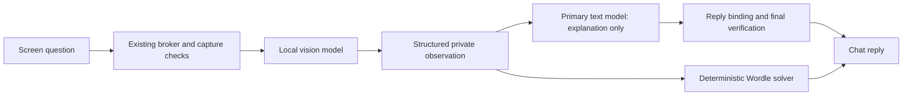

# Private vision-to-chat answers

The owner approved a fixed two-stage M5 handoff: the configured vision model reads
the authorized screenshot, then the active primary text model explains that reading
in natural language. Both GUI and terminal, including the general-application
wrapper used by `Chat-JarvisAll.py`, use this same path.



The text model receives the current owner question, bounded observation excerpts,
uncertainty, unreadable regions and limited relevant conversation. It receives no
pixels, executable paths, registered target list, tools or action permissions.
The observation and earlier context are separately labelled untrusted data. There
is one text-generation call, using the existing profile/provider and local-only
setup evidence. The vision model is not replaced or downloaded.

Fresh successful explanations display directly, without the old generic
`From the captured image` prefix. For example, the actual local model explained a
synthetic `ModuleNotFoundError` as a missing pandas package and suggested a next
step. It described an unreadable game title without inventing a famous game.
Suggestions are advice; JARVIS does not execute them through this answer path.

## Scope, context and validation

The admitted screen read keeps its original target, revision, grant, cancellation
and hard expiry throughout both stages. A shorter text-stage deadline is clamped
to that expiry. Changing the profile or target, revoking access, closing the
indicator or stopping prevents publication. The orb remains in its existing local
analysis state while the text model works; no extra capture occurs for synthesis.

The answer contract has only `kind`, `observation_id`, `text` and `evidence_ids`.
Whole JSON, byte/context limits, exact observation binding and controller-issued
evidence references are checked independently. Tool proposals, unknown fields,
invented references, wrong reply identity/revision and obvious first-person action
claims are rejected. These checks do not prove that every paraphrase is entailed:
both models can still misread, infer incorrectly or hallucinate. The role remains
read-only, and stronger image recognition is a separate evaluation problem.

Observation warnings remain visible. Exact warnings already present in the natural
reply are not repeated; paraphrased warnings may still repeat for clarity. Stale
images retain their capture-age notice. Wordle guesses continue through the
deterministic solver, including unreadable/contradictory-board handling; this text
stage cannot invent or replace a guess.

Up to two recent screen question/answer pairs are retained privately in memory and
used only for fresh observations of the same target. Explicit screen follow-ups
such as `Tell me more about it` can use that context. They still use the existing
on-demand screen path. A topic change clears the screen discussion context; expiry,
scope change, revoke and shutdown prevent its reuse. This is not general persistent
memory or unrestricted follow-up intent recognition.

Screen content and derived replies never enter ordinary chat history, public
research, currency requests or action planning. The last four ordinary chat messages
may supply bounded local context to a screen question; screen-derived information
does not flow back in the other direction. Journals contain hashes, normal action
receipts and safe failure categories, never screenshot content or answer prompts.

If explanation generation fails, JARVIS retains the independently validated vision
reading and reports that it could not finish the explanation. It records a safe
`screen_answer_fallback` category. It never substitutes fake/cloud inference,
repeats a desktop effect or displays an invalid text-model response.

## Settings and use

Restart the GUI or combined terminal chat to load the change. This PC's existing
private profile and `screen.toml` are reused; no new download or setup is required.
These optional **top-level** screen settings default to:

```toml
chat_answer_enabled = true
chat_answer_seconds = 30
```

Place them before `[companion]` if editing the private TOML. The shorter phase
budget can be 5–60 seconds and never extends the original task deadline. The active
primary text profile owns the model name, context/output limits and runtime options.
An optional `stage_options.screen-answer-v1` profile entry uses the existing bounded
stage-option schema. Default primary settings remain sufficient on this PC.

Try `Read my screen and explain this error and the next step`, `What game am I
looking at?` or `Read this chart and explain it simply`. Ordinary chat and app/media
actions retain their existing paths. Capture stays disabled without separately
selected enabled screen configuration, and no capture happens on startup.

## Actual validation

`tests/test_screen_answer.py` exercises the real answer adapter against scripted
providers and a mocked Ollama transport: source binding, whole-response parsing,
injection/action rejection, cancellation, liveness/target/profile changes, expiry,
bounded context, privacy, topic changes, duplicate delivery, Wordle isolation and
the combined application wrapper. Normal pytest performs no real capture or model
inference. Native capture/overlay code was unchanged for this feature.

The explicit live command uses synthetic evidence only:

```powershell
.\.venv\Scripts\python.exe scripts\Test-JarvisScreenChat.py --live `
  --profile "$env:LOCALAPPDATA\Jarvis\profiles\notepad-m2-concurrent-v1.toml" `
  --screen-config "$env:LOCALAPPDATA\Jarvis\screen.toml" `
  --report docs/evaluations/m5-screen-chat-next.json
```

The frozen six-case corpus uses scripted visual observations and **actual primary
text inference**. The final case uses a generated color pattern with **actual vision
and text inference** through the broker. There are zero real screen captures or
app/media effects. Reports refuse overwrite; r1 and r2 both passed 7/7. The corpus,
source hash, model identities and actual answers are retained in
`evaluations/m5-screen-chat-v1-r2.json`. These narrow protocol/keyword checks and
manual wording review do not establish universal factual grounding or naturalness.

On this PC: primary `qwen3:8b`, vision `qwen2.5vl:3b`, Ollama 0.40.2. The r2 text-only
cases took 1.60–3.32 s for the answer stage. Its two-real-model case took 4.94 s for
vision and 4.78 s for the text answer. The first r1 text call took 17.85 s; no
constant warm latency or simultaneous-model memory fit is promised. Requests are
sequential. The existing vision `keep_alive=0` behavior is retained.

The first reviewed report repeated an unreadable-region warning verbatim; exact
warning deduplication was added before r2 without changing the corpus or acceptance
threshold. Paraphrases can still duplicate some wording. Earlier results were
preserved. Both models remain fallible, and broader **M5 is NOT FULLY VERIFIED**.
This change does not qualify native capture, arbitrary game identification or new
desktop actions. No new packages/models, global settings, commit or push.
